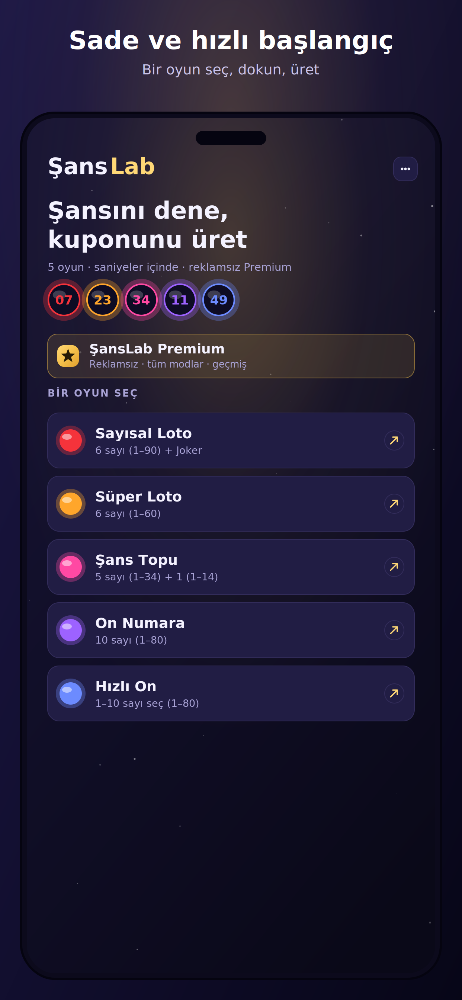
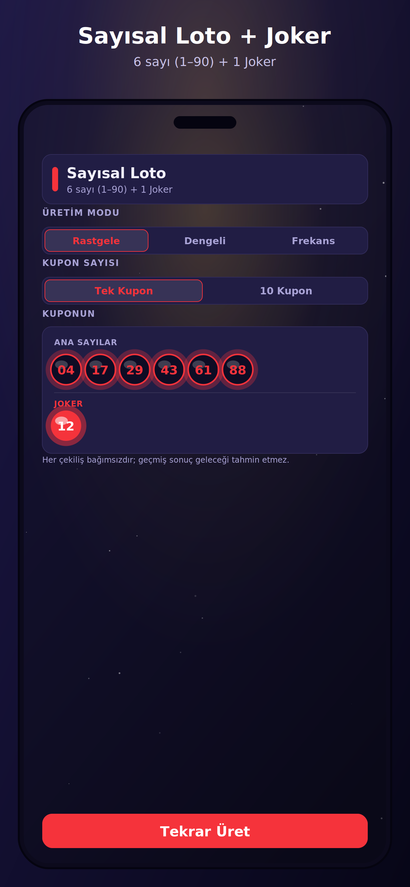
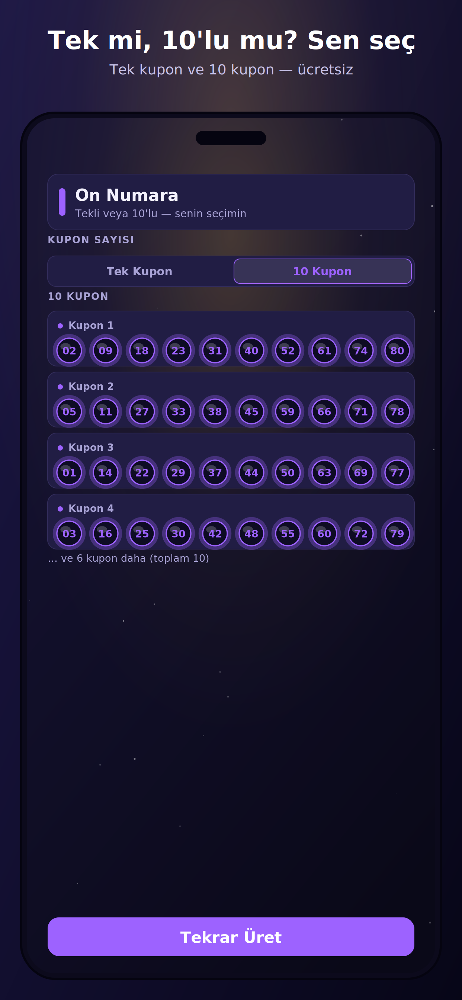
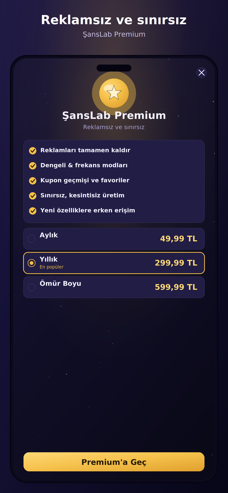
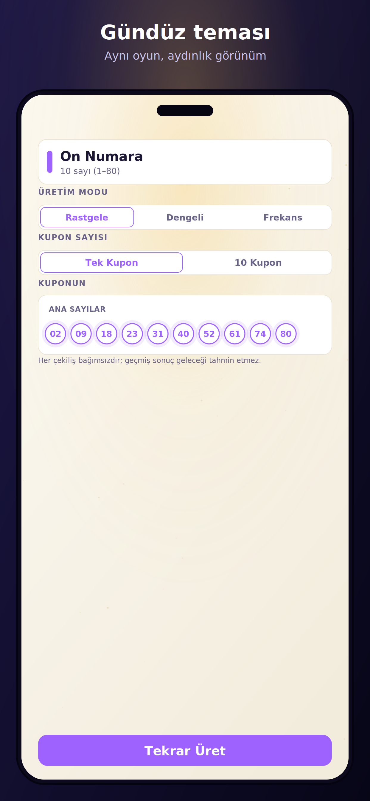

<div align="center">

# 🎱 ŞansLab

**Şansını dene, kuponunu üret.**

Türkiye'nin 5 şans oyunu için saniyeler içinde kupon üreten,
"Gece Çekilişi" kimlikli, dürüst freemium mobil uygulama.

`React Native` · `Expo SDK 54` · `TypeScript` · `iOS & Android`

[Özellikler](#-özellikler) · [ŞansFormülü](#-şansformülü) · [Kurulum](#-kurulum) · [Yayın](#-app-store--google-play-yayını) · [Mimari](#-mimari) · [Canlı Demo](web-demo/index.html)

</div>

---

## 📸 Ekranlar

<p align="center">
  
  
  
  
  
</p>

12 mağaza görselinin tamamı: [`store/screenshots/`](store/screenshots) · Galeri: [`store/MOCKUPS.html`](store/MOCKUPS.html)

---

## 🎯 Ürün

ŞansLab; **Sayısal Loto** (6/1–90 + Joker), **Süper Loto** (6/1–60), **Şans Topu** (5/1–34 + 1/1–14), **On Numara** (10/1–80) ve **Hızlı On** (1–10 sayı, 1–80) için kupon üretir. Akış bilinçli olarak yalın: *oyun seç → dokun → kuponun hazır.*

**Dürüstlük, ürünün temel duruşudur.** Çekilişler bağımsızdır; hiçbir mod kazanma olasılığını artırmaz ve uygulama bunu arayüzde açıkça söyler. Gerçek para ile oyun, bahis veya kupon satışı yoktur. Bu duruş hem etik hem stratejiktir: sahte "kazandıran tahmin" vaadi satan rakip kalabalığında güven ile ayrışır ve mağaza politikalarıyla uyumludur.

---

## ✨ Özellikler

| | Özellik | Detay |
|---|---|---|
| 🎮 | **5 oyun** | Kurallar tek kaynakta (`src/games/config.ts`); resmi kupon görsellerinden doğrulandı |
| 🎫 | **Tekli / 10'lu üretim** | İkisi de **ücretsiz**; 10'lu üretim tek dokunuş |
| 🎲 | **Kriptografik rastgelelik** | `expo-crypto` CSPRNG + reddetme örneklemesi (modülo yanlılığı yok) + Fisher–Yates; 20.000+ örnekle doğrulandı |
| 🧠 | **4 üretim modu** | Rastgele · Dengeli · Az Paylaşılan · **ŞansFormülü** |
| 🤝 | **Az Paylaşılan mod** | Popüler şablonlardan (doğum günü yoğunluğu, ardışık/aritmetik desen, şanslı-sayı kümesi) kaçınır — olasılık aynı, kazançta paylaşım düşer |
| 📈 | **ŞansFormülü modu** | 3.496 temiz çekilişlik arşiv analiziyle 7 bileşenli bileşik skor ([aşağıda](#-şansformülü)) |
| 📊 | **İstatistik paneli** | Frekans grafiği, sıcak/soğuk toplar, ki-kare tabanlı "dağılım adil mi?" okuması — açık "geçmiş ≠ gelecek" etiketiyle |
| 🌗 | **Gece & Gündüz teması** | İmza "Gece Çekilişi" tasarımı: gece-laciverdi tuval, altın vurgu, parlayan SVG toplar |
| 🌍 | **TR & EN** | i18next; cihaz dili algılama + kalıcı tercih |
| 📋 | **Kupona kopyala** | Tek dokunuşla panoya |
| 📴 | **Çevrimdışı** | Üretim internetsiz çalışır |
| 💎 | **Freemium** | RevenueCat abonelik + AdMob; aşağıda tablo |

### Freemium ayrımı

Kapıların **tek kaynağı** [`src/premium/gates.ts`](src/premium/gates.ts); paywall'da
vaat edilen her faydanın orada gerçek bir karşılığı olduğunu bir test doğrular.

| Özellik | Ücretsiz | Premium |
|---|:---:|:---:|
| Tüm 5 oyun | ✅ | ✅ |
| Tekli & 10'lu kupon | ✅ | ✅ |
| Rastgele mod | ✅ | ✅ |
| İstatistik paneli | ✅ | ✅ |
| Dengeli · Az Paylaşılan · ŞansFormülü | — | ✅ |
| Kupon geçmişi | son 10 | 500 |
| Favoriler | 3 | sınırsıza yakın |
| Geçmişi dışa aktar | — | ✅ |
| Reklamlar | Banner + her 4. üretimde interstitial | Yok |

Paketler: Aylık / Yıllık / Ömür Boyu (fiyatlar mağazadan dinamik; kodda sabit
fiyat yok). Yıllık plan varsayılan seçilir ve aylığa göre tasarruf yüzdesi
rozetiyle gösterilir.

### Hesap — **opsiyonel**

Uygulamanın tamamı üyeliksiz çalışır. Giriş yalnızca Premium'u ve kupon
geçmişini cihazlar arasında taşımak içindir (Android: Google · Facebook,
iOS: Apple · Google · Facebook — e-posta/şifre girişi yoktur).
Firebase yapılandırılmamış bir derlemede giriş ekranı kendini kapatır ve
uygulama misafir modunda tam çalışmaya devam eder. Mağaza zorunluluğu olan
**uygulama içi hesap silme** akışı mevcuttur (Ayarlar → Hesap → Hesabımı sil).

---

## 🧮 ŞansFormülü

Milli Piyango arşivi (Sayısal 6/90 dönemi **939**, Süper 6/60 dönemi **941**, Şans Topu **1.616** çekiliş) analiz edilerek kuruldu. Kritik veri temizliği: format değişimleri **veriden tespit edildi** (6/49→6/90: 03.08.2020, 6/54→6/60: 09.08.2020) ve dönemler ayrıştırıldı — aksi hâlde eski formatta var olmayan sayılar "soğuk" görünür ve formül çöp olurdu. Şans Topu'ndaki 2 bozuk kaynak satırı atıldı.

```
SKOR(K) = 0.15·F + 0.10·R + 0.10·G + 0.10·P + 0.15·S + 0.10·B + 0.30·A
```

| Bileşen | Anlamı |
|---|---|
| **F** Frekans | Temiz-dönem tüm-zaman frekans z-skoru ortalaması |
| **R** Form | Son 50 çekiliş frekans z'si (güncel seri) |
| **G** Gecikme | Beklenen gap'e göre normalize gecikme (overdue, 3× tavan) |
| **P** İkili sinerji | Kupondaki tüm ikililerin tarihsel lift ortalaması |
| **S** Toplam bandı | Kupon toplamının tarihsel dağılıma Gauss uyumu |
| **B** Desen | Tek/çift ve alt/üst dağılımının modal desene uyumu |
| **A** Anti-kalabalık | Yalnızca kalabalık *şablonları* cezalar (yoğun ≤31, ardışık zincir, aritmetik dizi, dar bant, şanslı-sayı kümesi) — sayı kimliği cezalanmaz |

**Üretim:** her istekte 3.500–6.000 aday (%70'i sıcaklık/form/gecikme ağırlıklı güdümlü örnekleme, %30 rastgele keşif) skorlanır; 10'lu üretimde kuponlar arası en fazla 2 ortak sayı kısıtıyla çeşitlendirilir. Joker/Şans Topu ek topu skor-ağırlıklı softmax ile seçilir (sıcaklar sık, tekel yok). Kupon kartında bileşik **SKOR** rozeti görünür.

**Dürüst çerçeve:** geçmiş istatistikler geleceği tahmin etmez; bu mod kazanma olasılığını **artırmaz** — arayüzde de böyle yazar. Geriye dönük testte (son 100 çekiliş, eğitimde görülmedi) eşleşme farkları gürültü bandındadır; A bileşeninin gerçek değeri kazanç anındaki paylaşım azalmasındadır.

**Kod & araçlar:**
- Motor: [`src/games/formula.ts`](src/games/formula.ts) · gömülü istatistik: [`src/games/fstats.ts`](src/games/fstats.ts)
- Analiz/CLI: [`tools/sans_formulu.py`](tools/sans_formulu.py) — `python3 tools/sans_formulu.py <arşiv.xlsx>`
- İstatistik tazeleme: arşivi güncelle → `python3 tools/export_fstats.py <arşiv.xlsx>` → `fstats.ts` yenilenir
- Tam analiz raporu: [`docs/SansLab_Sans_Formulu_Raporu.html`](docs/SansLab_Sans_Formulu_Raporu.html)

---

## 🏗 Mimari

```
app/                    Expo Router ekranları
├── _layout.tsx         Splash kontrolü · font/i18n yükleme · onboarding kapısı
├── index.tsx           Ana ekran (oyun listesi, premium şeridi, geçmiş girişi)
├── onboarding.tsx      4 slaytlık ilk açılış + yasal beyan → giriş ekranı (tek seferlik)
├── game/[id].tsx       Üretim ekranı (4 mod, tekli/10'lu, İstatistik girişi)
├── stats/[id].tsx      İstatistik paneli (frekans grafiği + adillik okuması)
├── history.tsx         Kupon geçmişi · favoriler · filtreler · dışa aktarma
├── paywall.tsx         RevenueCat paketleri / satın alma / geri yükleme
├── account.tsx         Profil · çıkış · uygulama içi HESAP SİLME (mağaza zorunluluğu)
├── settings.tsx        Hesap · dil · tema · yasal bağlantılar
└── (auth)/             OPSİYONEL giriş: sign-in · sign-up · forgot-password

src/
├── games/              ALAN MANTIĞI (UI'sız, test edilebilir)
│   ├── config.ts       Oyun kuralları (tek kaynak)
│   ├── generator.ts    CSPRNG + Fisher–Yates + 4 mod yönlendirme
│   ├── popularity.ts   Az Paylaşılan: şablon-cezalı popülerlik modeli
│   ├── formula.ts      ŞansFormülü: 7 bileşenli skor + güdümlü örnekleme
│   ├── fstats.ts       Gömülü temiz-dönem arşiv istatistikleri (~50 KB)
│   └── stats.ts        Frekans + ki-kare tabanlı adillik okuması
├── premium/            gates.ts (kapı politikası) · packages.ts (paket sunumu)
├── components/         Ball · Backdrop · CouponRow · GameCard · Buttons · Field · AdBanner
├── services/           env · auth · firebase · revenuecat · ads · consent (UMP)
├── state/              AppContext (tema · dil · premium · oturum) · history
├── test/               Sağlayıcılarla saran render yardımcısı
├── i18n/               tr · en
└── theme/              Gece/Gündüz token'ları + Sora/Inter

app.config.ts           Gizli dosya VARSA Firebase'i açar, YOKSA kapatır;
                        paket adı uyuşmazlığını yakalar; .env ile ezilebilir
landing/                Ürün landing page (statik, GitHub Pages'e uygun)
web-demo/               Tarayıcıda çalışan tam demo (tek dosya, 4 mod dahil)
store/                  TR/EN metadata · gizlilik · koşullar · 12 ekran görseli · galeri
docs/                   Teknik PDF · Tanıtım PDF · Sunum PPTX · Formül raporu
tools/                  sans_formulu.py (analiz CLI) · export_fstats.py
scripts/                gen_assets.py · gen_mockups.py (marka görselleri üretimi)
```

**Açılış akışı** (`_layout.tsx`): native splash **elle** tutulur → fontlar +
i18n + kalıcı durum yüklenir → splash kapanır. Reklam/satın alma/Firebase
başlatmaları ilk kareyi bloklamaz (`Promise.allSettled`). İlk açılışta
onboarding → giriş ekranı gösterilir; giriş opsiyoneldir (misafir geçilebilir)
ve bu adım geçilince akış bir daha gösterilmez. Splash, kullanıcı doğru ekrana
yönlendirildikten sonra kapanır. Anahtar/native modül
eksikse servisler sessizce devre dışı kalır ve uygulama çalışmaya devam eder.

### Teknoloji

`expo ~54` · `react-native 0.81` / `react 19` (New Architecture) · `expo-router 6` ·
`expo-crypto` · `react-native-svg` · `expo-linear-gradient` · `expo-splash-screen` ·
`expo-font` + `@expo-google-fonts/sora & inter` · `react-native-purchases` (RevenueCat) ·
`react-native-google-mobile-ads` + UMP · `@react-native-firebase` (Analytics ·
Crashlytics · **Auth**) · `@react-native-google-signin` · `expo-apple-authentication` ·
`i18next` · `AsyncStorage`

**Kalite:** `tsc --noEmit` (strict) · `eslint` (eslint-config-expo, 0 uyarı) ·
`jest` + `@testing-library/react-native` — 111 test / 6 paket · GitHub Actions CI.

---

## 🚀 Kurulum

**Node ≥ 20.19.4 gerekir** (`.nvmrc` → `nvm use`). Node 18 ile Expo SDK 54
derlenmez.

```bash
git clone https://github.com/<kullanici>/sanslab.git
cd sanslab
nvm use && npm install

# Anahtarsız çalışır: eksik gizli dosyalar otomatik algılanır
npx expo prebuild -p android --clean
npx expo run:android
```

Doğrulama (CI ile birebir aynı):

```bash
npm run verify
```

> `react-native-svg`, RevenueCat, AdMob ve Firebase native modüllerdir — tam
> doğrulama için **dev build / EAS build** kullanın. Expo Go'da UI ve üretim
> mantığı çalışır; satın alma/reklam/analytics zarifçe devre dışı kalır.

### Yapılandırma

Değerler `app.json → extra` altındadır ve **ortam değişkenleriyle ezilebilir**
(bkz. [`app.config.ts`](app.config.ts), [`.env.example`](.env.example)).
Hiçbiri zorunlu değildir; eksik olan SDK sessizce kapanır.

| Anahtar | Env | Açıklama |
|---|---|---|
| `eas.projectId` | — | EAS proje kimliği (ayarlı) |
| `revenuecat.ios` / `.android` | `REVENUECAT_*_KEY` | Public SDK key'leri (`appl_…` / `goog_…`) |
| `admob.*` | `ADMOB_*` | Banner/Interstitial birimleri (dev'de otomatik TestIds) |
| `auth.googleWebClientId` | `GOOGLE_WEB_CLIENT_ID` | Boşsa yayın derlemesinde "Google ile devam et" gizlenir |
| `auth.facebookAppId` / `.facebookClientToken` | `FACEBOOK_APP_ID` / `FACEBOOK_CLIENT_TOKEN` | İkisi de yoksa Facebook eklentisi eklenmez, buton yayında gizlenir |
| `links.*` | — | Gizlilik / koşullar / destek adresleri |

Firebase: `google-services.json` (Android) ve/veya `GoogleService-Info.plist`
(iOS) dosyalarını **proje köküne** koymanız yeterli — `app.config.ts`
varlıklarını algılayıp eklentileri kendisi ekler, `app.json`'a elle referans
yazmayın. Ayrıntılı adım adım: [`HANDOFF.md`](HANDOFF.md).

---

## 🏪 App Store & Google Play Yayını

Lansman kontrol listesi (ayrıntılar `HANDOFF.md`):

- [x] Uygulama kimliği: **`com.oditteknoloji.sanslab`** (Android + iOS, `google-services.json` ile eşleşiyor — ilk yayından sonra değiştirilemez)
- [x] Firebase'e **iOS** uygulaması eklendi + `GoogleService-Info.plist` (proje kökünde, git dışı)
- [x] EAS `projectId`: `93ce342c-547b-4e32-bae1-e0783dcc9e96`
- [ ] RevenueCat: entitlement `premium`, offering `default`, Aylık/Yıllık/Ömür Boyu ürünleri mağazalarda tanımlı
- [ ] AdMob gerçek birim kimlikleri + plugin App ID'leri
- [ ] AdMob **Privacy & messaging → GDPR mesajı** oluşturuldu (AEA/UK/CH zorunlu)
- [ ] Firebase yapılandırma dosyaları + Auth sağlayıcıları (Google · Facebook · Apple) açık
- [ ] Facebook uygulaması: App ID + Client token, key hash'ler, Firebase redirect URI (HANDOFF §5)
- [ ] Gizlilik & Koşullar URL'leri yayında (repo: [`store/privacy-policy.md`](store/privacy-policy.md), [`store/terms.md`](store/terms.md))
- [ ] Play **Data safety** formu: AD_ID · Analytics · Crashlytics · (hesap varsa) e-posta & ad
- [ ] Play **hesap silme** beyanı — uygulama içi akış mevcut (Ayarlar → Hesap)
- [ ] Yaş derecesi: **simulated gambling (17+/18+)**
- [ ] İnceleme notu: *gerçek para yok, bahis yok, Milli Piyango İdaresi ile bağlantısız, tüm modlar "olasılığı artırmaz" beyanlı*
- [ ] Ekran görselleri: `store/screenshots/` (öneri sırası: 01, 02, 03, 06, 09)
- [ ] TR/EN metadata: [`store/metadata-tr.md`](store/metadata-tr.md) / [`store/metadata-en.md`](store/metadata-en.md)
- [ ] `eas build --profile production --platform all` → `eas submit`

**Uyumluluk duruşu:** ŞansFormülü dahil hiçbir özellik kazanç vaadi olarak
sunulmaz; ilk açılış onboarding'inde dürüstlük ve 18 yaş beyanı, ayarlarda
sorumlu oyun bilgisi (TR: Yeşilay 115) vardır — bu metinlerin korunduğunu
`src/i18n/__tests__/i18n.test.ts` doğrular. iOS
`ITSAppUsesNonExemptEncryption=false` ayarlıdır. Hesap **opsiyoneldir**;
kuponlar yalnızca cihazda saklanır, sunucuya gönderilmez.

---

## 🖥 Landing Page & Web Demo

- **Landing:** [`landing/index.html`](landing/index.html) — Gece Çekilişi kimliğinde ürün sayfası (App Store/Play rozet alanları hazır). GitHub Pages'te `landing/` klasörüyle doğrudan yayınlanabilir.
- **Canlı demo:** [`web-demo/index.html`](web-demo/index.html) — tek dosya, internetsiz çalışır; 5 oyun, 4 mod (ŞansFormülü dahil, gömülü istatistiklerle), istatistik paneli, TR/EN, gece/gündüz.

---

## 📚 Dokümantasyon

| Belge | İçerik |
|---|---|
| [`docs/SansLab_Teknik_Dokuman.pdf`](docs/SansLab_Teknik_Dokuman.pdf) | Mimari, üretim motoru, modlar, servisler, güvenlik, EAS yayın |
| [`docs/SansLab_Urun_Tanitim.pdf`](docs/SansLab_Urun_Tanitim.pdf) | Görsel ürün broşürü (mockup'larla) |
| [`docs/SansLab_Sunum.pptx`](docs/SansLab_Sunum.pptx) | 12 slaytlık ürün sunumu (Sora/Inter gömülü) |
| [`docs/SansLab_Sans_Formulu_Raporu.html`](docs/SansLab_Sans_Formulu_Raporu.html) | Arşiv analizi + formül + backtest raporu |
| [`HANDOFF.md`](HANDOFF.md) | Geliştirici devir dokümanı (adım adım kurulum & yayın) |

---

## ⚖️ Yasal

**© 2026 Odit Teknoloji ve İletişim Hizmetleri Ticaret A.Ş. — Tüm hakları saklıdır.** Özel (proprietary) yazılımdır; bkz. [`LICENSE`](LICENSE).

ŞansLab, Milli Piyango İdaresi veya oyun operatörleriyle bağlantılı değildir. 18+ kullanıcılar içindir; yalnızca eğlence amaçlıdır. Her çekiliş bağımsızdır; hiçbir özellik kazanma olasılığını artırmaz.

<div align="center">

**support@odit.com.tr** · com.oditteknoloji.sanslab

</div>
